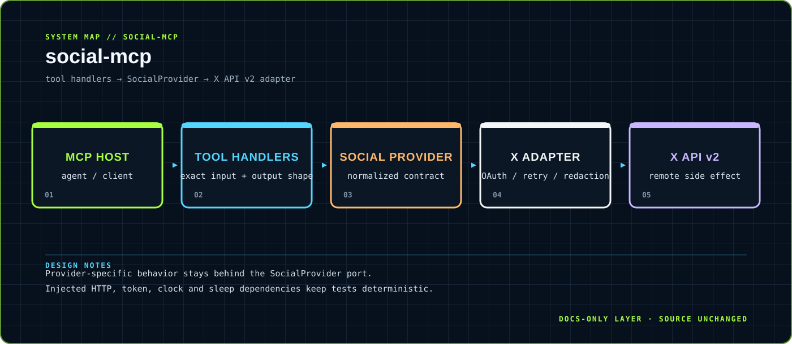

<div align="center">



</div>

# social-mcp

> A strict MCP social-tool surface with a normalized provider boundary.

Reference infrastructure for composing MCP-compatible social tools without coupling tool contracts to one provider implementation.

<div align="center">

`TypeScript · Node.js · MCP SDK` &nbsp;·&nbsp; `MCP tools: publish_post and get_analytics`

</div>

## `01 / SYSTEM CARD`

- **Primary boundary:** `tool handlers → SocialProvider → X API v2 adapter`
- **Documentation stance:** architecture and presentation only; application source is intentionally untouched.
- **Visual language:** Y2K terminal grid, brutalist labels, maximalist contrast, readable static SVG fallback.

## `02 / ARCHITECTURE`

The map above is a compact view of the repository's visible runtime boundary. It is designed to answer three questions quickly: where input enters, where policy or domain logic lives, and where external side effects leave the system.


## `03 / DESIGN NOTES`

- Provider-specific behavior stays behind the SocialProvider port.
- Injected HTTP, token, clock and sleep dependencies keep tests deterministic.

This upgrade adds documentation assets only. It does not change source files, dependency manifests, tests, workflows or runtime configuration.

## `04 / EXISTING PROJECT DOCUMENTATION`

<details open>
<summary>Read the original project notes</summary>

# social-mcp

A strict TypeScript starter for MCP social tools. It provides a normalized `SocialProvider` contract, exact MCP-compatible tool definitions, and an X API v2 adapter.

## API

- `publish_post`: calls `publish()`, or `reply()` when `replyToId` is present.
- `get_analytics`: calls `analytics()`.
- `XProvider`: maps those operations to X v2 `POST /2/tweets` and `GET /2/tweets/:id`.

Register `socialTools` with an MCP server and dispatch tool calls through `createSocialToolHandlers({ x: provider })`.

## X adapter guarantees

All side effects are injected: `HttpClient`, `TokenStore`, `Clock`, and `Sleep`. The provider refreshes OAuth tokens before expiry, performs at most one additional refresh after a 401, and transparently retries 429 responses within configured count and delay bounds. It honors both `retry-after` and `x-rate-limit-reset`, choosing the later deadline.

Errors use the allow-listed `SocialProviderError` shape. The provider has no logger and never places credentials, authorization headers, token request bodies, or raw responses in errors. A production `HttpClient` must apply the same redaction policy.

## Commands

Dependencies are exact-pinned. After an intentional install by the consumer:

```sh
npm run check
npm test
```

</details>

